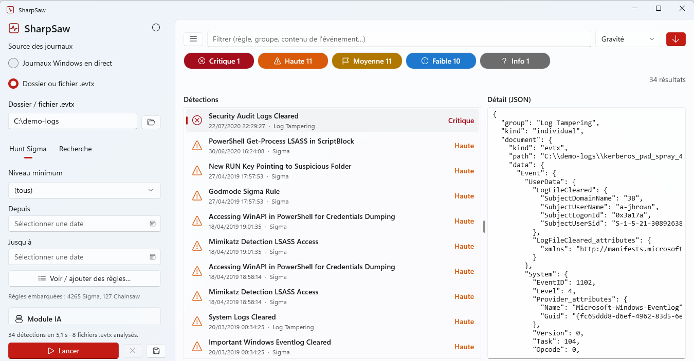
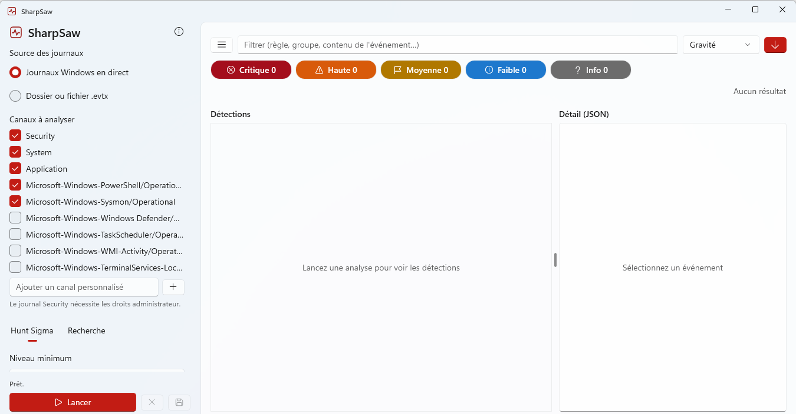
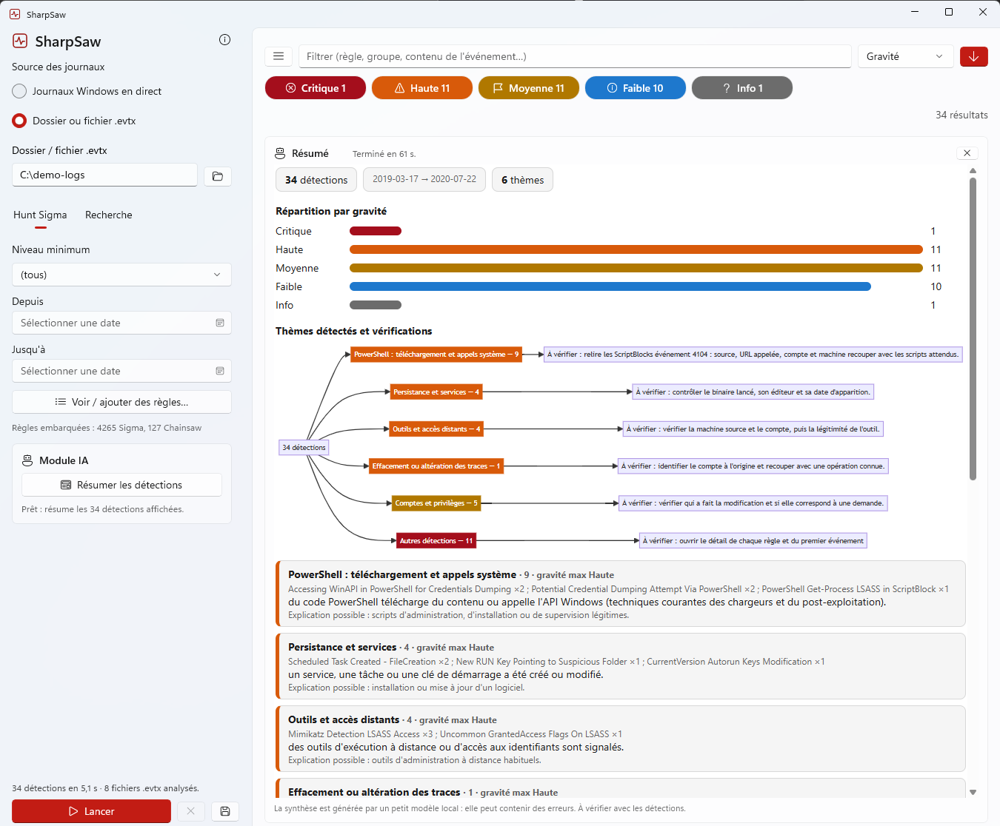

# SharpSaw

**Analyseur de journaux d'événements Windows, portable et 100 % hors ligne.**
SharpSaw applique les règles Sigma et Chainsaw à vos journaux (`.evtx` ou journaux Windows en direct), affiche les détections par gravité et en propose une synthèse générée par une IA locale. Un seul fichier `SharpSaw.exe`, sans installation, sans connexion réseau.



## Fonctionnalités

- **Hunt Sigma** : 4 265 règles Sigma et 127 règles Chainsaw embarquées, avec filtre par niveau minimum et par période.
- **Recherche** : motif texte ou expression régulière dans le contenu des événements.
- **Deux sources** : journaux Windows en direct (le journal *Security* demande les droits administrateur) ou dossier / fichier `.evtx`.
- **Règles personnelles** : ajout de vos propres règles (fichiers ou dossier), consultation et suppression depuis l'application.
- **Tri et filtre** des détections par gravité, date, règle ou groupe, avec le détail JSON de chaque événement.
- **Export** des résultats.
- **Module IA local** : résumé des détections (répartition par gravité, thèmes, vérifications à effectuer) par un petit modèle Gemma 3 1B exécuté sur CPU via llama.cpp. Rien ne quitte la machine.

| Accueil | Résumé IA |
|---|---|
|  |  |

> La synthèse est produite par un petit modèle local : elle peut contenir des erreurs. Elle sert à orienter l'analyse, à vérifier avec les détections.

## Utilisation

1. Téléchargez `SharpSaw.exe` depuis la page [Releases](../../releases).
2. Lancez-le. Au premier démarrage, l'application extrait ses composants (environ 1,7 Go) : prévoyez de l'espace libre sur le disque et un peu de patience.
3. Choisissez la source des journaux, puis cliquez sur **Lancer**.

Prérequis : Windows 10 (1809) ou plus récent, 64 bits.

## Compilation

Prérequis : [.NET SDK 8](https://dotnet.microsoft.com/download), [Rust](https://rustup.rs/) (`cargo`), Git, Visual Studio Build Tools (charge de travail C++).

```powershell
git clone <url-du-dépôt> SharpSaw
cd SharpSaw
.\scripts\build.ps1
```

Le script :

1. clone [Chainsaw](https://github.com/WithSecureOpenSource/chainsaw) à une version figée et compile `native-src/chainsaw_ffi` (la bibliothèque qui expose Chainsaw à l'application) ;
2. télécharge le modèle Gemma 3 1B (Q4_K_M, environ 770 Mo) ;
3. publie l'application en un seul fichier dans `dist\SharpSaw.exe`.

Le modèle et la DLL Chainsaw ne sont pas versionnés (taille) : ils sont reconstruits par le script.

## Organisation du dépôt

| Chemin | Rôle |
|---|---|
| `*.cs`, `*.xaml` | Application WinUI 3 (.NET 8) |
| `Resources/rules.zip` | Règles Sigma, Chainsaw et mappings embarqués |
| `native-src/chainsaw_ffi` | Crate Rust : interface C vers Chainsaw |
| `native/lamazero.dll` | Enveloppe llama.cpp pour le résumé IA |
| `scripts/build.ps1` | Construction complète |
| `docs/screenshots` | Captures d'écran |

## Licence

SharpSaw est distribué sous licence **GNU GPL v3** (voir [`LICENSE`](LICENSE)), car il intègre [Chainsaw](https://github.com/WithSecureOpenSource/chainsaw), lui-même sous GPL v3.
Les composants tiers (règles Sigma, modèle Gemma, llama.cpp, Mermaid, Windows App SDK) et leurs licences sont listés dans [`THIRD_PARTY_NOTICES.md`](THIRD_PARTY_NOTICES.md).
